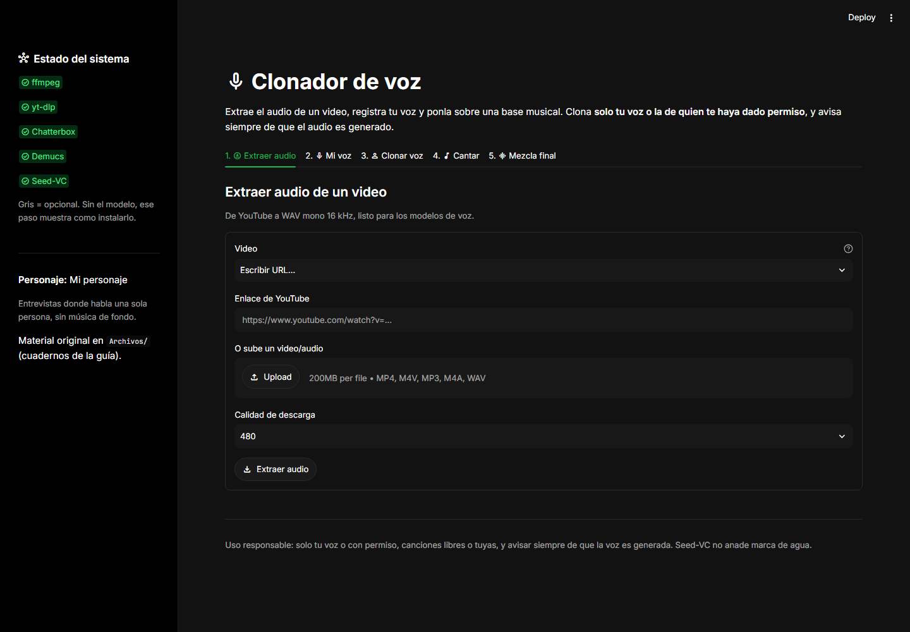

# Clonador de voz

[](https://www.python.org/)
[](https://streamlit.io/)
[](#pruebas)
[](LICENSE)

Extrae el audio de un vídeo, clona tu voz y ponla sobre una base musical.
Bot de Python y app de Streamlit con modelos de código abierto.

| Paso | Qué hace | Modelo |
|---|---|---|
| 1. Extraer | Vídeo de YouTube o archivo → WAV mono a 16 kHz | `yt-dlp` + `ffmpeg` |
| 2. Mi voz | Referencia de 10-20 s validada (duración, volumen y pico) | — |
| 3. Clonar | Texto a audio con tu voz, en 23 idiomas | Chatterbox Multilingual |
| 4. Cantar | La voz de una canción con tu timbre | Demucs + Seed-VC |
| 5. Mezclar | Voz clonada + base musical de fondo | — |

Los pasos 1, 2 y 5 funcionan sin GPU ni modelos. Los pasos 3 y 4 descargan
los modelos la primera vez que se usan.

## Vista previa



## Instalación

```bash
python -m venv .venv
.venv\Scripts\activate          # Windows (macOS/Linux: source .venv/bin/activate)
pip install -r requirements.txt
```

Hace falta `ffmpeg` y `ffprobe`: en Windows `winget install ffmpeg`, en macOS
`brew install ffmpeg` y en Linux `sudo apt install ffmpeg`. La app también los
busca en la carpeta de WinGet si el `PATH` no se ha actualizado.

## Uso

```bash
streamlit run app.py
```

Bot de línea de comandos (el mismo flujo sin interfaz):

```bash
python scripts/bot.py estado                          # qué hay instalado
python scripts/bot.py extraer URL_O_ARCHIVO           # sin argumentos: VIDEOS del .env
python scripts/bot.py clonar --voz data/referencias/mi_voz.wav --texto "Hola, mundo"
python scripts/bot.py separar data/audios/mi_audio.wav
python scripts/bot.py convertir --fuente data/separaciones/voz.wav --ref data/referencias/mi_voz.wav
python scripts/bot.py mezclar --voz data/clonados/voz.wav --base data/separaciones/inst.wav
```

`python scripts/bot.py <comando> --help` muestra todas las opciones.

### Configuración (.env)

El personaje y la lista de vídeos se definen en un único sitio, el archivo
`.env` de la raíz (no se sube a git):

```bash
cp .env.example .env   # Windows: copy .env.example .env
```

Variables: `PERSONAJE`, `DESCRIPCION`, `VIDEOS` (URLs o rutas separadas por
comas), `ALTURA_MAX`, `FS_VOZ` (16000) y `FS_MUSICA` (44100). Con `VIDEOS`
relleno, `python scripts/bot.py extraer` procesa todos los vídeos.

## Entornos con modelos

Chatterbox y Seed-VC piden versiones distintas de sus dependencias, así que van
en entornos separados. La app arranca sin ellos, explica cómo instalarlos y el
panel lateral indica qué falta en cada caso.

```bash
# Voz hablada (Python 3.11)
pip install -r requirements-voz.txt

# Voz cantada (Python 3.10) + carpeta seed-vc junto a la raíz
git clone https://github.com/Plachtaa/seed-vc.git
pip install -r requirements-canto.txt
```

Para usar Seed-VC desde la app, ejecútala en el entorno de
`requirements-canto.txt` (ya incluye Streamlit).

## Despliegue

- **Streamlit Community Cloud:** con `requirements.txt` y `packages.txt`
  (instala `ffmpeg`) funcionan los pasos 1, 2 y 5. Los pasos 3 y 4 necesitan
  modelos que no caben en ese plan gratuito, y la app los marca como no
  disponibles. La descarga directa de YouTube suele estar bloqueada desde
  servidores en la nube; subir el archivo funciona siempre.
- **Hugging Face Spaces:** el `Dockerfile` deja la app completa, con los modelos
  descargados durante el build, para un Space de CPU con 16 GB.

## Estructura

```text
app.py                 # App de Streamlit (punto de entrada)
scripts/bot.py         # Bot de línea de comandos
scripts/prefetch_modelos.py  # Descarga de modelos para el Dockerfile
src/
  config.py            # Rutas de data/, frecuencias y .env
  audio_extract.py     # Paso 1: yt-dlp + ffmpeg (con alternativa sin ffmpeg)
  utils.py             # WAV, validación, normalización y remuestreo
  clone_tts.py         # Paso 3: Chatterbox (carga perezosa)
  separate.py          # Paso 4a: Demucs separa voz e instrumental
  sing_convert.py      # Paso 4b: conversión cantada con Seed-VC
  mix.py               # Paso 5: mezcla de voz y base
data/                  # vídeos, audios, referencias, separaciones, clonados y mezclas
Archivos/              # Cuadernos del tutorial original
docs/GUIA_RAPIDA.md    # Guía de uso paso a paso
tests/                 # Tests unitarios + AppTest de Streamlit
```

## Pruebas

```bash
pip install -r requirements-dev.txt
pytest -q
```

Los tests cubren las utilidades de audio, la mezcla, la extracción local, la
separación, la clonación (con un modelo simulado), la conversión (con un motor
simulado) y el arranque de la app con `streamlit.testing.v1.AppTest`. No
descargan modelos. Con solo `requirements-dev.txt` pasan 75 y se saltan 4 que
necesitan `torch` o `huggingface_hub`; con los entornos de modelos pasan los 79.

## Requisitos y limitaciones

- La GPU es opcional, pero en CPU la conversión cantada tarda unos 10 minutos
  por cada 30 s de audio. Por eso el paso 4 permite convertir solo los primeros
  30 o 60 s.
- Seed-VC recorta la referencia a 25 s y procesa el audio por trozos.
- Demucs y Seed-VC descargan varios cientos de MB de pesos la primera vez.
- La mezcla recorta a la pista más corta y deja el pico en 0,98.
- La referencia de voz se normaliza de pico para que el modelo reciba siempre
  el mismo nivel.

## Uso responsable

Clona solo tu voz o la de alguien que te haya dado permiso, usa canciones
libres o propias y avisa siempre de que el audio es generado. Chatterbox añade
una marca de agua detectable; Seed-VC no añade ninguna.

## Licencia

[MIT](LICENSE). Los modelos (Chatterbox, Seed-VC y Demucs) tienen sus propias
licencias en sus repositorios.
